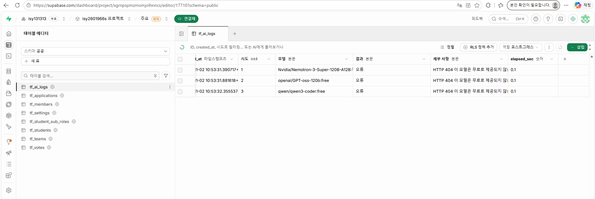
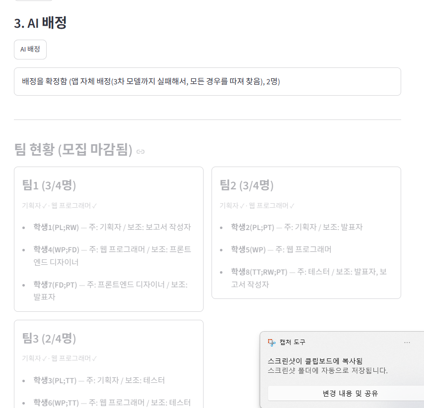
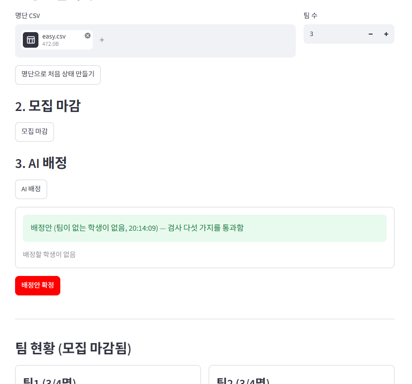

# 팀 프로젝트 팀 편성 웹 앱 (중간 과제)

작성자: lsy131313

## 1. 배포 주소
https://team-formation-lsy.streamlit.app

## 2. PRD와 구현 계획의 위치
- PRD: `docs/PRD.md`
- 구현 계획: `docs/구현 계획.md`
- DB 테이블: `schema.sql`

## 3. 고른 해결 방법
| 기능 | 고른 해결 | 방법 |
|---|---|---|
| 다른 사람의 변경 보기 | 어려운 해결 | `st.fragment(run_every=3)`로 3초마다 바뀐 부분만 다시 그림 |
| 필수 포함 역할을 지킬 수 없는 팀 | 어려운 해결 | 지원할 때 "남는 자리 수 < 아직 못 채운 필수 역할 수"이면 막음 (`core.join_problem`) |
| 같은 팀에 대기 중인 지원이 여럿 | 어려운 해결 | 모든 팀원이 찬성한 순간 규칙을 다시 검사함. 팀 행 잠금으로 투표가 끝난 순서대로 처리 |
| 마지막 자리에 두 명이 동시에 들어감 | 어려운 해결 | `tf_members`의 기본 키 `(team_id, slot_no)`와 `student_id unique` (`schema.sql`) |
| AI 응답이 늦을 때 | 어려운 해결 | 모델마다 호출부터 응답까지 120초 전체 대기 시간을 재서 끊고 다음 모델로 넘어감 (`core.ai_assign`) |
| 3차 모델까지 실패 | 어려운 해결 | 백트래킹으로 모든 경우를 따져 검사 5가지를 통과하는 배정을 찾음 (`core.solve_assignment`) |
| AI 대기 중 화면 | 어려운 해결 | "N차 모델(이름)의 응답을 기다리는 중… 37초 / 120초"를 1초마다 갱신 |
| DB 일시정지 막기 | 어려운 해결 | GitHub Actions 예약 실행으로 매일 DB 질의 (`.github/workflows/keepalive.yml`) |

## 4. 쓴 모델 3개
Streamlit Secrets의 `MODEL_1`, `MODEL_2`, `MODEL_3`으로 정함
- 1차: `google/gemma-4-31b-it:free`
- 2차: `nvidia/nemotron-3-ultra-550b-a55b:free`
- 3차: `thinkingmachines/inkling:free`

## 5. 오픈라우터 AI 모델 호출 실패 사례
2026-11-02 19:53(한국 시각), 연습용 쉬움 시나리오 6단계에서 "AI 배정"을 눌렀을 때 처음 정했던 1차 `nvidia/nemotron-3-super-120b-a12b:free`, 2차 `openai/gpt-oss-120b:free`, 3차 `qwen/qwen3-coder:free`가 모두 **HTTP 404 (이 모델은 무료로 제공되지 않음)**으로 0.1초 만에 실패함. 앱은 1차 → 2차 → 3차로 넘어갔고, 3차까지 실패하자 모든 경우를 따져 규칙을 지키는 배정을 스스로 찾아 확정함.

AI 호출 기록(`tf_ai_logs` 테이블):



앱 자체 배정 결과:



## 6. 클로드가 잘못된 추론이나 답변을 한 사례
클로드가 코드의 기본 모델로 넣은 무료 모델 3개(위 5항)가, 과제를 하던 2026년 11월에는 이미 오픈라우터 무료 목록에서 빠진 모델이었음. 클로드는 예전 정보를 바탕으로 지금도 무료라고 가정함.
- **알아챈 방법**: 쉬움 시나리오에서 AI 배정 결과가 "앱 자체 배정(3차 모델까지 실패해서…)"으로 나와서 이상하다고 생각함. `tf_ai_logs` 테이블에서 세 모델 모두 HTTP 404였음을 확인함 (위 5항의 AI 호출 기록 화면).
- **고친 방법**: 현재 무료 모델 목록을 다시 확인하고, 코드를 바꾸지 않고 Streamlit Secrets에 `MODEL_1~3`을 넣어 지금 무료인 모델로 바꿈 (4항).

## 7. 제출한 앱에서 발견한 문제점이나 개선 필요 사항
연습용 쉬움 시나리오 6단계에서 배정안을 확정한 뒤에도 "AI 배정" 단추를 다시 누를 수 있음. 누르면 배정할 학생이 없는 빈 배정안과 "배정안 확정" 단추가 또 나타남. 확정이 끝났으면 "AI 배정" 단추를 막거나 "이미 배정을 확정함"이라고 안내해야 함.



## 실행 방법(로컬)
```bash
pip install -r requirements.txt
# .env.example 을 복사해 .env 로 만들고 값을 채움
streamlit run streamlit_app.py
```
